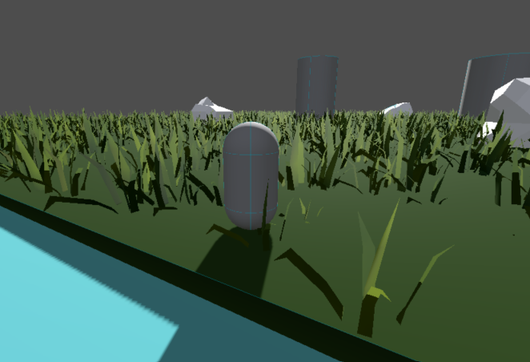

# Fourth Light
A 3D exploration game made in Godot. Check it out at [itch.io](https://viywolf.itch.io/fourth-light).

Godot 4.7 and Blender 4.3 was used to make this project.

## How To Play
Go to the [itch.io page](https://viywolf.itch.io/fourth-light) and download the executable that you want to play. There are multiple versions of it based on my progress on it (Week 2 is currently the latest one). A web version of the Week 1 version is also available though it is extremely slow at loading stages and does not play well on certain browsers (Firefox was a bit janky, Chrome seemed fine though). 

## Features

### Week 1
- Movement
- Swimming + diving
- Gliding (press Q while midair to glide, direct your movement by looking in the direction you want to go)
- A few decoration element such as grass, water, and rocks on the main scene

### Week 2
- Added a demo stage for chunk loading which will probably be used in the main stage eventually.
- Added a settings menu with volume control, FPS, and chunk loading control.
- Added a sky background, loading screen, walls to water, and general minor improvements.
